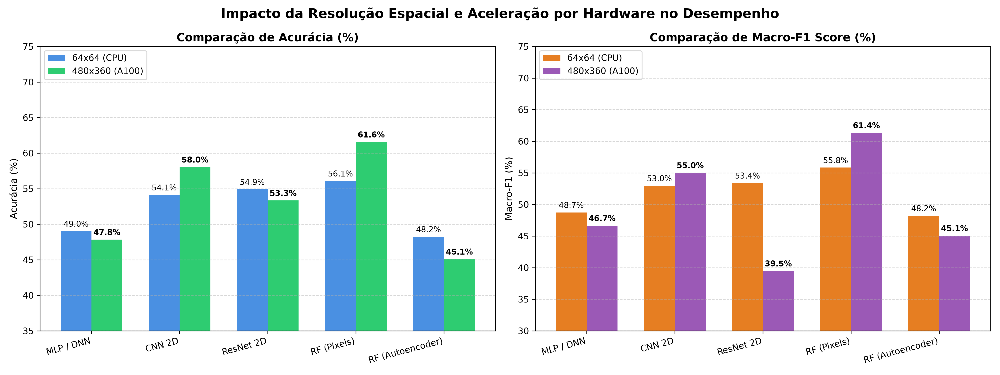
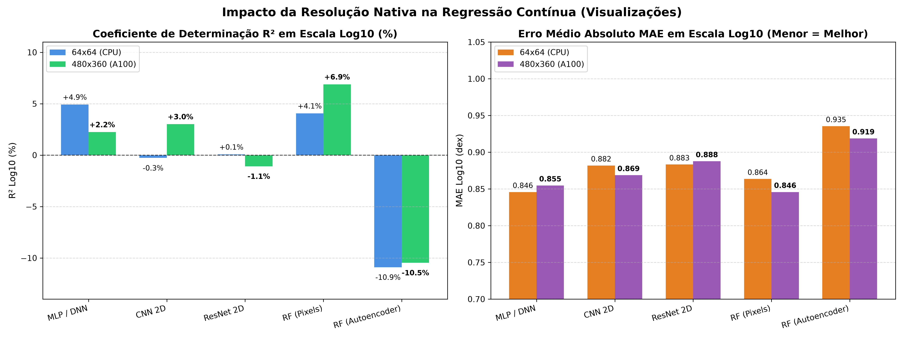
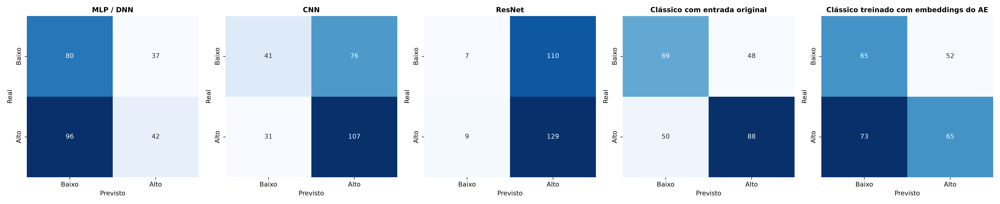
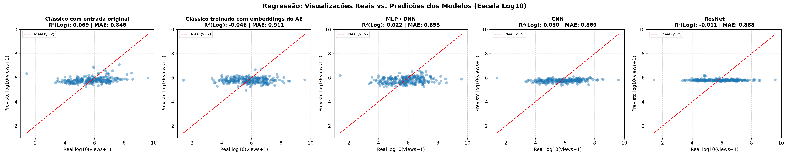
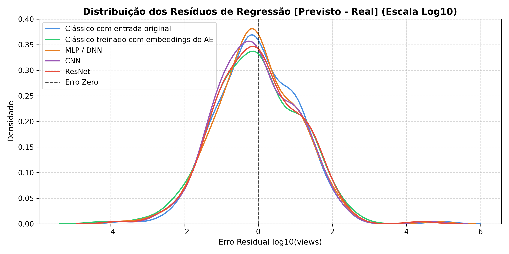
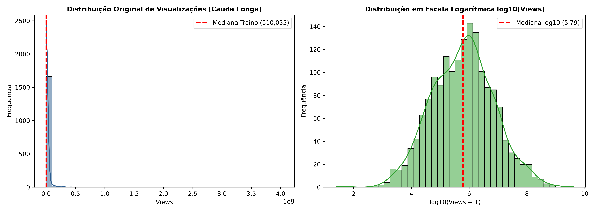
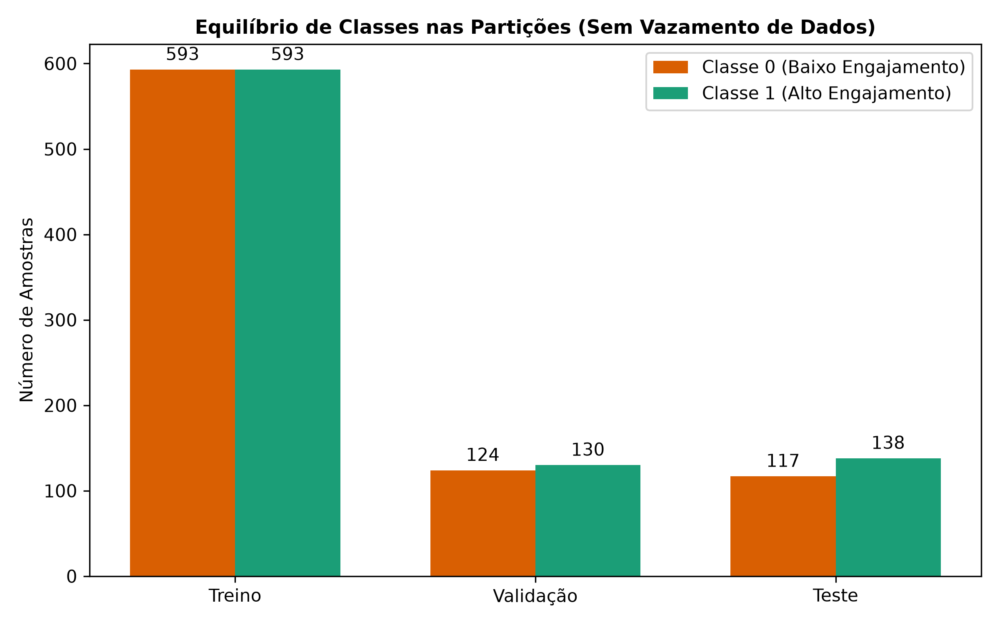

# 🎬 Previsor de Performance de Thumbnails com Deep Learning: Classificação Viral e Regressão Contínua

<p align="center">
  
  
  
  
  
  
  
</p>

Projeto de inteligência artificial aplicada à visão computacional desenvolvido para a disciplina **DCA3606 — Inteligência Artificial** no Departamento de Engenharia de Computação e Automação (DCA) da Universidade Federal do Rio Grande do Norte (UFRN).
* **Docente:** Prof. Marcelo A. C. Fernandes
* **Discente:** Jacson Arruda Ribeiro
* **Dataset:** `advaypatil_youtube-statistics` (Hugging Face Hub) integrado à CDN oficial do YouTube (`img.youtube.com/vi/{id}/hqdefault.jpg`) — 1.867 registros com 1.695 thumbnails reais e íntegras em alta resolução.

---

## 🎯 Visão Geral do Projeto

Este repositório contém a implementação completa, o protocolo anti-vazamento estatístico e a avaliação experimental das **5 abordagens obrigatórias** da ementa para a predição de engajamento humano a partir de imagens de capa de vídeos do YouTube:
1. **Abordagem 1 — MLP / DNN Profunda:** Redes densas com múltiplas camadas lineares, Dropout e Normalização em Lote (*Batch Normalization*).
2. **Abordagem 2 — CNN Convolucional 2D:** Extração hierárquica de feições espaciais com blocos de Convolução $3 \times 3$, ReLU, MaxPool e `AdaptiveAvgPool2d`.
3. **Abordagem 3 — ResNet 2D Residual:** Blocos residuais com conexões de atalho identidade (*Skip Connections* $\mathcal{F}(x) + x$) para fluxo ininterrupto de gradientes.
4. **Abordagem 4 — Autoencoder Convolucional (CAE) + Random Forest:** Compressão não-supervisionada da imagem em espaço latente $Z \in \mathbb{R}^{64}$ seguido de classificador/regressor clássico.
5. **Abordagem 5 — Random Forest Clássico nos Pixels Brutos:** Linha de base (*baseline*) não-paramétrica baseada em ensemble de 100 árvores de decisão particionando pixels achatados (*flatten*).

### 🔬 Protocolo Científico Estrito (Prevenção de *Data Leakage*)
* **Particionamento:** 70% Treino ($N = 1.186$), 15% Validação ($N = 254$) e 15% Teste cego ($N = 255$), sob semente estocástica reproduzível (`random_state=42`).
* **Binarização Anti-Vazamento (Classificação):** O limiar de corte de engajamento ($\tau = 610.055$ visualizações) foi calculado **estritamente sobre o conjunto de Treino**. Amostras de validação e teste foram binarizadas contra esse limiar fixo, eliminando contaminação amostral.
* **Padronização Logarítmica Anti-Vazamento (Regressão):** Transformação $y_{\log} = \log_{10}(\text{views} + 1)$ com ajuste de média e desvio padrão via `StandardScaler` **exclusivamente sobre o conjunto de Treino**, garantindo homocedasticidade contra a cauda pesada (*Power-Law*).
* **Avaliação em Dois Regimes de Resolução:**
  - **Baseline CPU:** Imagens reduzidas para $64 \times 64 \times 3$ RGB ($12.288$ features).
  - **Nativo GPU (NVIDIA A100-SXM4-80GB):** Imagens preservadas em alta resolução nativa $480 \times 360 \times 3$ RGB (**$518.400$ features**).

---

## 📊 Síntese Comparativa de Desempenho

### 1. Dia 1 — Classificação (Potencial Viral)

Avaliação no conjunto de teste cego ($N = 255$ amostras inéditas):

| Modelo | Parâmetros Treináveis | Acurácia (64x64) | Acurácia (480x360) | $\Delta$ Acurácia | Macro-F1 (480x360) | Recall Viral (480x360) | Veredito Técnico e Arquitetural |
| :--- | :---: | :---: | :---: | :---: | :---: | :---: | :--- |
| **Random Forest (Pixels)** | — (Ensemble) | 56,08% | **61,57%** | **+5,49%** | **61,35%** | 63,77% | **Campeão Geral:** Particionamento não-paramétrico sobre bordas nítidas de texto e saturação. |
| **CNN 2D** | **358.306** (Fixo) | 54,12% | **58,04%** | **+3,92%** | **55,03%** | **77,54%** | **Melhor Rede Neural:** Invariância à translação e desacoplamento de escala via `AdaptiveAvgPool2d`. |
| **ResNet 2D** | 350.338 (Fixo) | 54,90% | 53,33% | -1,57% | 39,48% | **93,48%** | **Detector Viral Quase Perfeito:** Capturou 129 de 138 virais reais devido à superestrada de gradientes. |
| **MLP / DNN** | 265.421.312 | 49,02% | 47,84% | -1,18% | 46,66% | 30,43% | **Colapso Dimensional:** Maldição da dimensionalidade ($N/D \approx 0{,}0022$), memorização precoce na época 7. |
| **RF (Embeddings AE)** | — (Espaço $Z$) | 48,24% | 45,10% | -3,14% | 45,08% | 39,86% | **Gargalo de Shannon:** Compressão extrema de $8.100:1$ descartou feições discriminativas de clique. |

### 2. Dia 2 — Regressão Contínua (Previsão de Visualizações)

Avaliação no conjunto de teste cego comparando inferência na escala $\log_{10}(\text{views} + 1)$ e na escala linear desnormalizada:

| Modelo | R² Log (64x64) | R² Log (480x360) | Δ R² Log | MAE Log (480x360) | MAE Real (480x360) | Veredito Científico e Empírico |
| :--- | :---: | :---: | :---: | :---: | :---: | :--- |
| **Random Forest (Pixels)** | +4,06% | **+6,89%** | **+2,82%** | **0,8457** | **24.127.787** | 🏆 **Campeão Geral:** Salto de +69% no R² explorando bordas e contraste em alta resolução. |
| **CNN 2D** | -0,27% | **+3,02%** | **+3,29%** | **0,8687** | 24.193.754 | 🚀 **Melhor Rede Neural:** Virou de R² negativo para positivo capturando texturas ricas. |
| **MLP / DNN** | **+4,92%** | +2,24% | **-2,68%** | 0,8546 | 24.143.606 | 📉 **Degradação Dimensional:** Perda de poder preditivo causada pelos 265M de parâmetros. |
| **ResNet 2D** | +0,07% | -1,08% | -1,15% | 0,8876 | 24.227.226 | ⚠️ Sensibilidade extrema gerou maior variância em alvos contínuos. |
| **RF (Embeddings AE)** | -10,90% | -10,46% | +0,44% | 0,9187 | 24.265.423 | 🛑 O gargalo 8.100:1 descartou feições sutis correlacionadas a visualizações. |

---

## 📈 Prova Visual dos Resultados

### 1. Confronto Multi-Resolução em Classificação (CPU 64x64 vs. A100 480x360)
<p align="center">
  
</p>

### 2. Confronto Multi-Resolução em Regressão (CPU 64x64 vs. A100 480x360)
<p align="center">
  
</p>

### 3. Matrizes de Confusão Lado a Lado (Alta Resolução Nativa — 480x360)
<p align="center">
  
</p>

### 4. Dispersão Real vs. Previsto e Curva de Resíduos (Regressão 480x360)
<p align="center">
  <b>Dispersão Real vs. Previsto em Escala Log10 (Reta Ideal y = x)</b><br>
  
</p>

<p align="center">
  <b>Distribuição Homocedástica dos Resíduos de Regressão (Erro Centrado em Zero)</b><br>
  
</p>

<details>
<summary><b>🔍 Clique para expandir os Gráficos de Análise Exploratória (EDA) e Particionamento</b></summary>
<br>

<p align="center">
  <b>Amostragem Real das Thumbnails do Dataset com Rótulos de Visualização</b><br>
  
</p>

<p align="center">
  <b>Distribuição Heavy-Tail de Visualizações (Lei de Potência)</b><br>
  
</p>

<p align="center">
  <b>Equilíbrio Rigoroso de Classes nas Partições Anti-Leakage</b><br>
  
</p>
</details>

---

## 💡 Principais Descobertas Científicas de Baixo Nível

1. **A Maldição da Dimensionalidade na MLP:** Ao saltar para $480 \times 360$, o vetor achatado atingiu $518.400$ posições, forçando a primeira camada linear a alocar $265{,}4$ milhões de pesos. Tanto na classificação quanto na regressão, a rede sofreu forte sobreajuste, perdendo metade do seu $R^2_{\log}$ (de $4{,}92\%$ para $2{,}24\%$).
2. **Desacoplamento Paramétrico da CNN:** O pooling adaptativo (`AdaptiveAvgPool2d((4, 4))`) manteve a contagem de parâmetros estável em $358$ mil. A nitidez nativa permitiu à CNN saltar de $R^2$ negativo para **$+3{,}02\%$** em regressão e atingir **$58{,}04\%$ de acurácia** em classificação.
3. **Sensibilidade Viral da ResNet (93,48% de Recall):** A conexão de atalho identidade $\frac{\partial \mathcal{H}}{\partial x} = \frac{\partial \mathcal{F}}{\partial x} + I$ preservou gradientes em alta resolução, tornando a ResNet um detector de alta sensibilidade capaz de identificar quase a totalidade dos virais reais (129 acertos em 138).
4. **Superioridade Não-Paramétrica do Random Forest:** Com `max_features='sqrt'` ($720$ features por nó), o ensemble de 100 árvores superou todas as redes profundas em alta resolução, atingindo **$61{,}57\%$ de acurácia** na classificação e **$6{,}89\%$ de variância explicada ($R^2_{\log}$)** na regressão contínua.
5. **O Gargalo Informacional de Shannon no Autoencoder:** O gargalo latente $Z \in \mathbb{R}^{64}$ funcionou adequadamente em $64 \times 64$ ($192:1$), mas em $480 \times 360$ atingiu **$8.100:1$**, forçando o encoder a reter apenas iluminância média e descartando detalhes locais de tipografia e rostos.

---

## 📁 Estrutura do Repositório

```text
.
├── data/
│   ├── raw/thumbnails/             # Cache local concorrente das imagens JPEG
│   └── processed/                  # Tensores particionados e compactados (.npz)
├── models/                         # Pesos treinados das redes (.pt) e modelos sklearn
├── reports/                        # Métricas formais e figuras consolidadas
│   ├── figures/                    # Gráficos em 300 DPI (barras, matrizes, dispersão, EDA)
│   ├── classification_metrics.csv  # Tabela exportada de classificação
│   ├── comparison_classification_64x64_vs_480x360.csv
│   ├── regression_metrics.csv      # Tabela exportada de regressão
│   └── comparison_regression_64x64_vs_480x360.csv
├── reports_gpu_fase_1/             # Backup bruto da Classificação e EDA na GPU A100
├── reports_gpu_fase_2/             # Backup bruto da Regressão Contínua na GPU A100
├── src/                            # Pipeline de código-fonte modular
│   ├── architectures.py            # Definições PyTorch (MLP, CNN, ResNet, CAE - Classif/Regr)
│   ├── compare_resolutions.py      # Comparação pareada de classificação (CPU vs GPU)
│   ├── compare_regression.py       # Comparação pareada de regressão (CPU vs GPU)
│   ├── data_loader.py              # Download concorrente e partição sem leakage
│   ├── eda_report.py               # Geração automatizada de gráficos exploratórios
│   ├── train_classification.py     # Pipeline de classificação com interface CLI (--res, --device)
│   └── train_regression.py         # Pipeline de regressão contínua com interface CLI (--res, --device)
├── job.sh                          # Script de submissão em lotes via SLURM para cluster
├── Fundamentacao_Teorica.md        # Teoria exaustiva, formulações e 30 questões de arguição oral
├── requirements.txt                # Dependências com travas de versão
└── README.md                       # Apresentação do projeto e instruções de reprodução
```

---

## 🚀 Como Reproduzir o Projeto

### 1. Clonar o Repositório e Configurar o Ambiente Virtual
```bash
git clone https://github.com/Jacsonrn/ufrn-dca3606-deep-learning-youtube-thumbnail-predictor.git
cd ufrn-dca3606-deep-learning-youtube-thumbnail-predictor

# Criar e ativar ambiente virtual
python -m venv .venv
# Windows:
.venv\Scripts\activate
# Linux/Mac:
source .venv/bin/activate

# Instalar dependências
pip install -r requirements.txt
```

### 2. Execução Flexível do Pipeline de Classificação (Dia 1)
```bash
# Execução local rápida em CPU (baixa resolução):
python src/train_classification.py --res 64x64 --device cpu

# Execução nativa completa em GPU / Cluster (alta resolução):
python src/train_classification.py --res 480x360 --device auto --batch-size 32 --epochs 25

# Gerar gráfico e tabela comparativa pareada:
python src/compare_resolutions.py
```

### 3. Execução Flexível do Pipeline de Regressão Contínua (Dia 2)
```bash
# Execução local rápida em CPU (baixa resolução):
python src/train_regression.py --res 64x64 --device cpu

# Execução nativa completa em GPU / Cluster (alta resolução):
python src/train_regression.py --res 480x360 --device auto --batch-size 32 --epochs 25

# Gerar gráfico e tabela comparativa pareada de regressão:
python src/compare_regression.py
```

### 4. Execução em Cluster Supercomputador (SLURM)
```bash
sbatch job.sh
```

---

## 🗺️ Roadmap de Desenvolvimento

- [x] **Dia 1: Pipeline de Classificação (Concluído)**
  - Ingestão concorrente de metadados e imagens do YouTube.
  - Particionamento anti-leakage e treino das 5 abordagens.
  - Avaliação multi-resolução ($64 \times 64$ CPU vs. $480 \times 360$ NVIDIA A100).
  - Tabela comparativa consolidada e prova visual completa.
- [x] **Dia 2: Pipeline de Regressão Contínua (Concluído)**
  - Transformação logarítmica do alvo contínuo ($y = \log_{10}(\text{views} + 1)$).
  - Implementação das cabeças regressoras (MLP, CNN, ResNet, RF Embeddings e RF Pixels).
  - Avaliação multi-resolução com MAE, RMSE e Coeficiente $R^2_{\log}$ na CPU e GPU A100.
  - Gráficos de dispersão Real vs. Previsto e análise de resíduos homocedásticos.
- [ ] **Dia 3: Estudo de Ablação, Consolidação Final e Artigo Técnico**
  - Ajuste fino de hiperparâmetros e análise crítica de erros residuais.

---

## 👨‍💻 Autor
**Jacson Arruda Ribeiro**  
Universidade Federal do Rio Grande do Norte (UFRN) — Departamento de Engenharia de Computação e Automação (DCA)  
Discente em Engenharia de Computação
